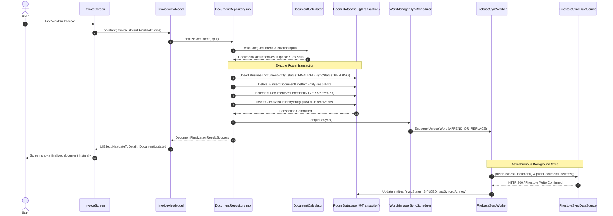
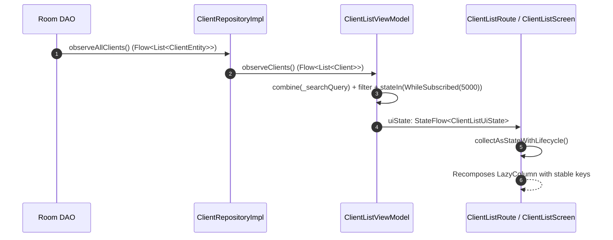

<!-- refreshed: 2026-11-17 -->
# Vivaan Enterprise Architecture

**Analysis Date:** 2026-11-17

## System Overview

```text
┌───────────────────────────────────────────────────────────────────────────┐
│                           PRESENTATION LAYER (MVI)                        │
├─────────────────────────────────────┬─────────────────────────────────────┤
│  Compose Route (`*Route.kt`)        │  Stateless Screen (`*Screen.kt`)    │
│  • Obtains ViewModel via Hilt       │  • Consumes immutable UiState       │
│  • Binds collectAsStateWithLifecycle│  • Emits UI events via callbacks    │
│  • Collects UiEffect one-shot events│  • Pure UI previewable layout       │
└──────────────────────────────────┬──┴─────────────────────────────────────┘
                                   │
                                   ▼
┌───────────────────────────────────────────────────────────────────────────┐
│                               VIEWMODEL LAYER                             │
│  `app/src/main/java/com/vivaanenterprise/app/feature/**/presentation/`    │
│  • Holds and mutates `StateFlow<UiState>` via `stateIn()`                 │
│  • Exposes `Channel<UiEffect>` as `receiveAsFlow()`                       │
│  • Handles `UiIntent` / `UiAction` dispatched by user interactions        │
└──────────────────────────────────┬──┴─────────────────────────────────────┘
                                   │
                                   ▼
┌───────────────────────────────────────────────────────────────────────────┐
│                                DOMAIN LAYER                               │
│  `app/src/main/java/com/vivaanenterprise/app/domain/`                     │
│  • UseCases: `GenerateBusinessDocumentPdfUseCase`                         │
│  • Deterministic Calculation: `DocumentCalculator` (Long paise, basis pts)│
│  • Pure Kotlin Models: `BusinessDocument`, `Client`, `Product`, etc.      │
│  • Repository Interfaces: `DocumentRepository`, `ClientRepository`, etc.  │
└───────────────────┬─────────────────────────────────┬─────────────────────┘
                    │                                 │
                    ▼                                 ▼
┌─────────────────────────────────────┐   ┌─────────────────────────────────┐
│           PDF ENGINE LAYER          │   │         REPOSITORY LAYER        │
│ `com.vivaanenterprise.app.core.pdf` │   │ `com.vivaanenterprise.app.data` │
│ • Native `PdfDocument` generation   │   │ • `DocumentRepositoryImpl`      │
│ • Renders frozen snapshots          │   │ • `ClientRepositoryImpl`        │
│ • In-app `PdfRenderer` session      │   │ • Multi-table `@Transaction`   │
└─────────────────────────────────────┘   └─────────┬───────────────────────┘
                                                    │
                 ┌──────────────────────────────────┴──────────────────┐
                 ▼                                                     ▼
┌─────────────────────────────────────┐               ┌─────────────────────────────────┐
│     ROOM DATABASE (SOURCE OF TRUTH) │               │      WORKMANAGER BACKGROUND     │
│ `com.vivaanenterprise.app.core.db`  │               │ `com.vivaanenterprise.app.core. │
│ • `VivaanEnterpriseDatabase`        │               │   sync.WorkManagerSyncScheduler`│
│ • Local DAOs emitting `Flow`        │               │ • `FirebaseSyncWorker`          │
│ • Sync Status (`PENDING`/`SYNCED`)  │               │ • Appends or replaces unique job│
└─────────────────────────────────────┘               └────────────────┬────────────────┘
                                                                       │
                                                                       ▼
                                                      ┌─────────────────────────────────┐
                                                      │     REMOTE BACKEND (FIRESTORE)  │
                                                      │ `com.vivaanenterprise.app.data. │
                                                      │   remote.FirestoreSyncDataSource│
                                                      │ • Push pending local changes    │
                                                      │ • Pull ordered hierarchy        │
                                                      └─────────────────────────────────┘
```

## Component Responsibilities

| Component | Responsibility | File |
|-----------|----------------|------|
| `VivaanEnterpriseApplication` | Application entry point, initializes Hilt dependency graph and custom `HiltWorkerFactory` for WorkManager | `app/src/main/java/com/vivaanenterprise/app/VivaanEnterpriseApplication.kt` |
| `MainActivity` | Single activity host, splash screen initialization, edge-to-edge system bar configuration, sets Compose root | `app/src/main/java/com/vivaanenterprise/app/MainActivity.kt` |
| `AppNavHost` | Central navigation coordinator, auth lifecycle reaction, typed destination routes | `app/src/main/java/com/vivaanenterprise/app/app/navigation/AppNavHost.kt` |
| `Screen` | Sealed navigation destination hierarchy with typed argument helpers and routes | `app/src/main/java/com/vivaanenterprise/app/app/navigation/Screen.kt` |
| `DocumentCalculator` | Single deterministic authority for GST tax split, rounding (half-up), line item extensions, and grand totals | `app/src/main/java/com/vivaanenterprise/app/domain/util/DocumentCalculator.kt` |
| `DocumentRepositoryImpl` | Orchestrates document creation, draft edits, transactional snapshot finalization, and sequence allocation | `app/src/main/java/com/vivaanenterprise/app/data/repository/DocumentRepositoryImpl.kt` |
| `SyncRepositoryImpl` | Bidirectional offline synchronization engine; pushes pending entities and pulls remote collections in strict dependency order | `app/src/main/java/com/vivaanenterprise/app/data/repository/SyncRepositoryImpl.kt` |
| `SyncMergePolicy` | Pure domain policy evaluating conflict resolution between local records and incoming Firestore DTOs | `app/src/main/java/com/vivaanenterprise/app/domain/repository/SyncMergePolicy.kt` |
| `WorkManagerSyncScheduler` | Schedules network-constrained background sync jobs using `APPEND_OR_REPLACE` policy | `app/src/main/java/com/vivaanenterprise/app/core/sync/SyncScheduler.kt` |
| `FirebaseSyncWorker` | Hilt-injected CoroutineWorker triggered by WorkManager to execute synchronization | `app/src/main/java/com/vivaanenterprise/app/core/sync/FirebaseSyncWorker.kt` |
| `AndroidBusinessDocumentPdfGenerator` | Generates pixel-perfect A4 PDF documents from frozen document snapshots using native Android `PdfDocument` | `app/src/main/java/com/vivaanenterprise/app/core/pdf/AndroidBusinessDocumentPdfGenerator.kt` |
| `VivaanEnterpriseDatabase` | Room database definition with 7 entities, schema exports, type converters, and migration routines | `app/src/main/java/com/vivaanenterprise/app/core/database/VivaanEnterpriseDatabase.kt` |
| `AppPreferencesDataStore` / `SyncPreferencesDataStore` | Encapsulates Android Jetpack DataStore Preferences for UI state and sync cursor timestamps | `app/src/main/java/com/vivaanenterprise/app/core/datastore/SyncPreferencesDataStore.kt` |

## Pattern Overview

**Overall:** Unidirectional Data Flow (UDF) with Model-View-Intent (MVI) presentation and Offline-First Local Source of Truth Repository pattern.

**Key Characteristics:**
- **Strict MVI Contracts**: Every screen is defined by a triad: `UiState` (immutable data class/sealed hierarchy), `UiIntent` / `UiAction` (user intents), and `UiEffect` (one-shot transient navigation/snackbar events).
- **Route vs Screen Separation**: ViewModels are scoped strictly in `*Route` composables. `*Screen` composables are 100% stateless, receiving `uiState: UiState` and `onIntent: (UiIntent) -> Unit`.
- **Room as the Sole Source of Truth**: All UI reading occurs via reactive `Flow` streams from Room DAOs through repositories. The UI layer never observes Firestore directly.
- **Integer Minor Unit Financials**: All monetary quantities are stored and computed as `Long` paise (1 INR = 100 paise), and GST rates are stored as `Int` basis points (1% = 100 bp). Floating point numbers (`Double`, `Float`) are strictly prohibited in calculation and persistence.
- **Immutable Document Snapshots**: Finalizing a `TAX_INVOICE` or `PURCHASE_ORDER` creates frozen copies of the seller profile, client info, and product descriptions inside the document record, shielding historical billing from catalog modifications.

## Layers

### Presentation Layer (`feature/`, `app/navigation/`)
- Purpose: Render Material 3 UI, capture user gestures, observe reactive state, and handle navigation.
- Location: `app/src/main/java/com/vivaanenterprise/app/feature/` and `app/src/main/java/com/vivaanenterprise/app/app/navigation/`
- Contains: Composable screens, routes, ViewModels, and UI contracts (`*Contracts.kt`, `*UiState.kt`).
- Depends on: `domain/`, `core/designsystem/`, `core/common/`.
- Used by: Android system via `MainActivity`.

### Domain Layer (`domain/`)
- Purpose: House enterprise business rules, pure data models, calculation algorithms, and repository contracts.
- Location: `app/src/main/java/com/vivaanenterprise/app/domain/`
- Contains: Domain models (`BusinessDocument`, `Client`, `Product`), utility calculators (`DocumentCalculator`, `IndianCurrencyFormatter`, `FinancialYearResolver`), and use cases (`GenerateBusinessDocumentPdfUseCase`).
- Depends on: Pure Kotlin standard library (free of Android framework dependencies).
- Used by: `feature/` (presentation layer) and `data/` (repository implementations).

### Data Layer (`data/`)
- Purpose: Coordinate local persistence and remote data synchronization, mapping between entity models, DTOs, and domain models.
- Location: `app/src/main/java/com/vivaanenterprise/app/data/`
- Contains: Repository implementations (`DocumentRepositoryImpl`, `ClientRepositoryImpl`, `SyncRepositoryImpl`), local mappers (`DocumentMappers.kt`), remote DTOs (`RemoteDtos.kt`), and Firestore datasources (`FirestoreSyncDataSource.kt`).
- Depends on: `domain/`, `core/database/`, `core/datastore/`, `core/firebase/`, `core/sync/`.
- Used by: ViewModels and UseCases.

### Core Infrastructure Layer (`core/`)
- Purpose: Provide shared technical infrastructure across database, data store, design tokens, PDF rendering, and background workers.
- Location: `app/src/main/java/com/vivaanenterprise/app/core/`
- Contains: Room database & DAOs (`core/database/`), DataStore preferences (`core/datastore/`), Design System themes & tokens (`core/designsystem/`), PDF generator (`core/pdf/`), and WorkManager sync scheduler (`core/sync/`).
- Depends on: Android Jetpack libraries, Room, WorkManager, Hilt, Firebase SDK.
- Used by: `data/`, `domain/`, `feature/`.

## Data Flow

### Primary Request Path: Document Finalization (Offline-First Write)



1. **User interaction**: User clicks "Finalize" on `InvoiceScreen.kt:320`.
2. **Intent dispatch**: Dispatches `InvoiceUiIntent.FinalizeInvoice` to `InvoiceViewModel.kt:180`.
3. **Repository invocation**: Invokes `DocumentRepositoryImpl.finalizeDocument()` (`DocumentRepositoryImpl.kt:224`).
4. **Deterministic Calculation**: Evaluates totals using `DocumentCalculator.calculate()` (`DocumentRepositoryImpl.kt:292`).
5. **Database Transaction**: Executes `database.withTransaction { ... }` (`DocumentRepositoryImpl.kt:417`):
   - Inserts finalized `BusinessDocumentEntity` with immutable snapshots (`DocumentRepositoryImpl.kt:419`).
   - Inserts frozen `DocumentLineItemEntity` snapshots (`DocumentRepositoryImpl.kt:423`).
   - Increments `DocumentSequenceEntity` (`DocumentRepositoryImpl.kt:428`).
   - Creates `ClientAccountEntryEntity` receivable ledger row (`DocumentRepositoryImpl.kt:441`).
6. **Background Sync Trigger**: Calls `syncScheduler.enqueueSync()` (`DocumentRepositoryImpl.kt:460`).
7. **WorkManager execution**: `FirebaseSyncWorker` runs `SyncRepositoryImpl.synchronize()`, pushing records to Firestore (`SyncRepositoryImpl.kt:76`) and marking local entities `SYNCED` (`SyncRepositoryImpl.kt:81`).

### Secondary Flow: Reactive Data Observation (Read Path)



1. Room DAO exposes reactive query `Flow<List<ClientEntity>>` (`ClientDao.kt:22`).
2. Repository maps entities to domain models `Flow<List<Client>>` (`ClientRepositoryImpl.kt:30`).
3. ViewModel combines repository flow with user filter queries (`ClientListViewModel.kt:26`).
4. ViewModel converts to state via `stateIn(SharingStarted.WhileSubscribed(5_000))` (`ClientListViewModel.kt:44`).
5. Route composable collects state with lifecycle safety via `collectAsStateWithLifecycle()` (`ClientListScreen.kt:51`).

### State Management
- **UI State**: Encapsulated in single immutable data classes (e.g., `ClientListUiState`, `InvoiceUiState`, `PurchaseOrderUiState`).
- **One-Shot Events**: Channels with buffered capacity exposed via `receiveAsFlow()` (e.g., `ClientListUiEffect`, `InvoiceUiEffect`).
- **Database State**: Single source of truth in local SQLite via Room (`VivaanEnterpriseDatabase`).

## Key Abstractions

### `DocumentCalculator`
- **Purpose**: Centralized deterministic financial mathematics engine. Eliminates rounding discrepancy between UI previews, database records, and generated PDF reports.
- **Location**: `app/src/main/java/com/vivaanenterprise/app/domain/util/DocumentCalculator.kt`
- **Pattern**: Pure Strategy / Domain Service. Enforces `Long` paise arithmetic and exact integer basis point calculations.

### `BusinessDocumentPdfGenerator`
- **Purpose**: Contract for dynamic on-demand PDF rendering from frozen historical snapshots without storing binary blobs in database tables.
- **Location**: `app/src/main/java/com/vivaanenterprise/app/domain/pdf/BusinessDocumentPdfGenerator.kt`
- **Implementation**: `app/src/main/java/com/vivaanenterprise/app/core/pdf/AndroidBusinessDocumentPdfGenerator.kt`
- **Pattern**: Strategy / Abstract Factory.

### `SyncMergePolicy`
- **Purpose**: Pure domain rules defining whether an incoming remote Firestore DTO should overwrite or be rejected by local Room entity state.
- **Location**: `app/src/main/java/com/vivaanenterprise/app/domain/repository/SyncMergePolicy.kt`
- **Pattern**: Specification / Policy pattern. Guarantees that local pending edits and finalized historical documents are immutable to remote drift.

## Entry Points

### Android Application Entry Point
- **Location**: `app/src/main/java/com/vivaanenterprise/app/VivaanEnterpriseApplication.kt`
- **Triggers**: Android OS process launch.
- **Responsibilities**: Initializes Hilt dependency injection, injects `HiltWorkerFactory` into `Configuration.Provider` for WorkManager.

### Activity Entry Point
- **Location**: `app/src/main/java/com/vivaanenterprise/app/MainActivity.kt`
- **Triggers**: Launcher intent (`android.intent.action.MAIN`).
- **Responsibilities**: Calls `installSplashScreen()`, sets `enableEdgeToEdge()`, binds `VivaanEnterpriseApp()` root composable.

### Root Navigation Entry Point
- **Location**: `app/src/main/java/com/vivaanenterprise/app/app/VivaanEnterpriseApp.kt` & `app/src/main/java/com/vivaanenterprise/app/app/navigation/AppNavHost.kt`
- **Triggers**: Composable composition.
- **Responsibilities**: Observes `authStateFlow` (`AuthState.SignedOut` vs `AuthState.SignedIn`), seeds initial business profile and product catalog on first sign-in, manages screen routes.

## Architectural Constraints

- **Threading Model**: Coroutines structured concurrency. UI interactions run on `Dispatchers.Main`; disk/database I/O operates on `Dispatchers.IO`; intensive PDF drawing and financial math run on default/IO contexts. `GlobalScope` is strictly prohibited.
- **Offline-First Storage**: Room database is the sole local source of truth. UI never accesses network or Firestore directly.
- **Monetary Precision**: `Double` and `Float` are forbidden for currency rates and totals. All amounts must use integer `Long` paise and integer basis points (`Int`).
- **Dynamic PDF Generation**: Permanent PDF file binaries (`.pdf`) must not be stored in Room or Firestore. They are generated on demand into temporary cache storage (`context.cacheDir`).
- **File Sharing Security**: Outgoing PDF sharing must use Android `FileProvider` with temporary read permission `content://` URIs. Raw `file://` URIs are forbidden.
- **Destructive Database Migrations**: `fallbackToDestructiveMigration()` is forbidden in production builds. Schema migrations are strictly versioned (`app/src/main/java/com/vivaanenterprise/app/core/database/migration/DatabaseMigrations.kt`).

## Anti-Patterns

### Anti-Pattern 1: Direct Firestore Observation in ViewModels
**What happens:** ViewModel listens directly to Firestore collection snapshots (`addSnapshotListener`).
**Why it's wrong:** Breaks the offline-first guarantee, causes flickering or blank states without connectivity, and bypasses Room local transaction isolation.
**Do this instead:** Observe Room DAO `Flow` from repository; let `WorkManagerSyncScheduler` and `SyncRepositoryImpl` update Room in the background. Reference: `app/src/main/java/com/vivaanenterprise/app/data/repository/ClientRepositoryImpl.kt:30`.

### Anti-Pattern 2: Duplicating Financial Calculation Formulas
**What happens:** Recomputing tax amounts (CGST, SGST, IGST) or totals directly in Composable screens or PDF canvas code.
**Why it's wrong:** Results in rounding discrepancies, diverging totals between screen display, PDF printouts, and database ledgers.
**Do this instead:** Always pass data through `DocumentCalculator.calculate()` and consume `DocumentCalculationResult`. Reference: `app/src/main/java/com/vivaanenterprise/app/domain/util/DocumentCalculator.kt`.

### Anti-Pattern 3: Passing ViewModels into Child Composables
**What happens:** Injecting or passing a `ViewModel` instance deep down the Composable hierarchy.
**Why it's wrong:** Inhibits Composable previews, destroys testability, and couples UI layout to business logic lifecycle.
**Do this instead:** Scope ViewModel to `*Route` composable, and pass pure immutable `UiState` and event lambdas `(UiIntent) -> Unit` into stateless `*Screen` composables. Reference: `app/src/main/java/com/vivaanenterprise/app/feature/client/presentation/list/ClientListScreen.kt:44`.

## Error Handling

**Strategy:** Clean typed error propagation using Kotlin `Result<T>` and sealed failure hierarchies in domain models.

**Patterns:**
- **Validation Errors**: Sealed classes representing specific validation issues (e.g., `DocumentValidationError.MissingSellerProfile`, `DocumentValidationError.BlankDocumentNumber` in `DocumentValidation.kt`).
- **Calculation Failures**: `CalculationException` wrapping `CalculationError` (e.g., `InvalidStateCode`, `ArithmeticOverflow` in `CalculationError.kt`).
- **Sync Failures**: Caught within `FirebaseSyncWorker` and `SyncRepositoryImpl`; local records are marked `syncStatus = SyncStatus.FAILED` with sanitized error summaries, triggering WorkManager exponential retry without crashing the app.
- **Coroutines Cancellation**: `CancellationException` is explicitly rethrown in all try/catch blocks to prevent breaking coroutine cancellation hierarchies.

## Cross-Cutting Concerns

**Logging:** Restricted to debug builds; no sensitive client financials, PAN, or GSTIN tokens logged to plain-text Logcat.
**Validation:** Domain-layer validation rules (`ClientValidationUtils.kt`, `DocumentValidation.kt`, `EmailValidator.kt`) validate inputs before entities are written to disk.
**Authentication:** Firebase Authentication managed via `AuthRepositoryImpl`, exposing state as `StateFlow<AuthState>`. Unauthenticated sessions are redirected to `Screen.Login`.
**Currency Formatting:** Handled universally by `IndianCurrencyFormatter.kt` using standard Indian numbering format (e.g., `₹ 1,50,000.00`) and Indian English amounts in words.

---

*Architecture analysis: 2026-11-17*
